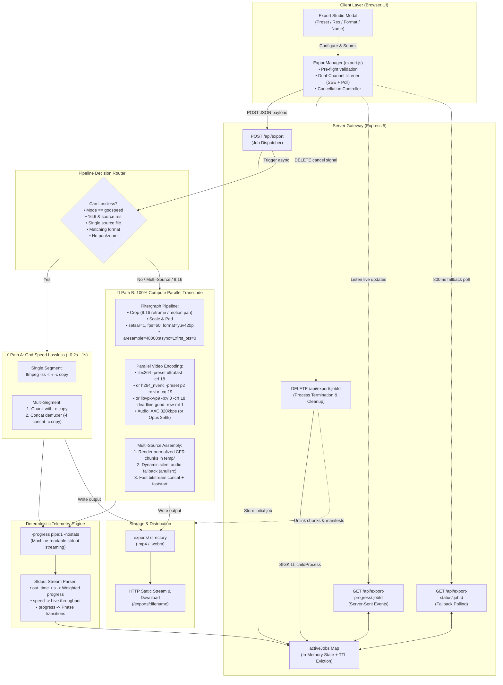

# MonoCut — Video Export Architecture & Pipeline Specification

This document provides a comprehensive technical specification and architectural breakdown of the video export engine in **MonoCut**.

The export architecture is engineered for:
1. **Ultra-Low Latency & High Throughput**: Sub-second lossless cuts and multi-core parallel rendering.
2. **Mathematical Bitstream Purity**: 0.00% generational loss for stream-copy operations.
3. **Deterministic Synchronization**: Strict VFR-to-CFR normalization and audio PTS realignment eliminating boundary drift.
4. **Resilient Process Lifecycle**: Machine-readable telemetry (`-progress pipe:1`), graceful process cancellation, and automated TTL garbage collection.

---

## 1. System Architecture Overview

MonoCut utilizes a **hybrid dual-engine architecture**:
- **⚡ Path A: God Speed Lossless Stream Copy**: Native bitstream demuxing/remuxing (`-c copy`) executing at **60x–100x speed** with zero CPU strain and mathematical 0.00% generational quality loss.
- **🚀 Path B: 100% Compute Parallel Transcode Engine**: High-throughput multi-threaded rendering utilizing 100% of all logical CPU cores (`-threads 0 -preset ultrafast -crf 18`) or hardware-accelerated NVENC (`-c:v h264_nvenc -preset p2 -rc vbr -cq 19`) for multi-source combining, cross-codec transcoding, and 9:16 vertical re-framing.



---

## 2. Core Components

### 2.1 Client Controller (`public/js/export.js`)
- **Pre-flight Estimation**: Dynamically calculates estimated output file sizes using duration and target bitrates (~6.5 Mbps for 1080p Shorts, ~16 Mbps for 4K).
- **Engine Preview**: Evaluates user inputs in real-time to preview which engine will be invoked (`⚡ GOD SPEED`, `🚀 MAX COMPUTE`, or `📱 SHORTS 9:16`).
- **Interactive Cancellation**: Provides an explicit "Cancel Export" control that triggers `DELETE /api/export/:jobId`, aborts ongoing network streams, and resets the interface.
- **Dual-Channel Telemetry Listener**:
  - Connects to `/api/export-progress/:jobId` using `EventSource` (SSE).
  - Simultaneously registers an 800ms polling fallback via `/api/export-status/:jobId`.
  - Ensures seamless progress updates even if SSE connections stall or drop during heavy I/O operations.

### 2.2 Server Gateway & Job Dispatcher (`server.js`)
- **`POST /api/export`**: Receives cut list, crop/zoom offsets, and output preferences.
- **Probe & Path Verification**: Validates file existence on disk, resolves network/drive paths, and runs `ffprobe` to determine audio presence, frame rates, and container formats.
- **Async Execution**: Responds immediately with `{ jobId, totalCutDuration }` and spawns `runExportPipeline()` asynchronously.

---

## 3. Decision Logic & Execution Paths

Before encoding begins, the router validates whether a lossless bitstream copy is viable:

```javascript
const canLossless = (mode === 'godspeed') &&
                    (aspectRatio === '16:9') &&
                    (resolution === 'source') &&
                    !hasZoom && !hasMotionPan &&
                    !hasMultipleSources && !anyMuted &&
                    allSameExt && formatMatchesSource;
```

### Path A: ⚡ God Speed Lossless Stream Copy
Used when trimming or splicing from a single source video without format, aspect ratio, or geometric transformations.

1. **Single Segment**:
   ```bash
   ffmpeg -y -ss <start> -t <duration> -i <source> \
     -c copy -avoid_negative_ts make_zero <output> \
     -progress pipe:1 -nostats
   ```
2. **Multi-Segment Splicing**:
   - Each segment is sliced into `temp/clip_<jobId>_<index>.<ext>` using `-c copy`.
   - A manifest file `temp/concat_<jobId>.txt` is written using relative basenames (`file 'clip_...'`).
   - The FFmpeg Concat Demuxer joins the clips with zero re-encoding:
     ```bash
     ffmpeg -y -f concat -safe 0 -i concat_<jobId>.txt -c copy -movflags +faststart <output> -progress pipe:1 -nostats
     ```
   - *Working Directory Safety*: The concat command runs with `cwd: TEMP_DIR`, preventing Windows absolute path escaping issues.

### Path B: 🚀 100% Compute Parallel Transcode Engine
Used when reframing (16:9 to 9:16 Shorts), applying motion panning/zooming, or combining multiple distinct video sources.

#### 1. VFR-to-CFR & Stream Normalization
To prevent variable frame rate (VFR) synchronization bugs, audio/video desync, and concatenation stutter across diverse input sources, MonoCut enforces strict stream normalization:
- **Constant Frame Rate (CFR) Enforcement**: Appends `fps=${targetFps}` (defaulting to `60` for Shorts/Reels or source FPS for 16:9) to the geometric filtergraph:
  ```bash
  crop=...,scale=...,pad=...,setsar=1,fps=60,format=yuv420p
  ```
- **SAR & Pixel Format Locking**: `setsar=1` locks square pixel aspect ratios and `format=yuv420p` ensures unified 8-bit 4:2:0 planar chroma subsampling across all chunks before concatenation.

#### 2. Audio Timestamp Alignment & Synthesis
- **Clips WITH Native Audio**: Applies asynchronous resampling and presentation timestamp (PTS) realignment:
  ```bash
  -af "aresample=48000:async=1:first_pts=0,aformat=sample_fmts=fltp:channel_layouts=stereo"
  ```
  `async=1` dynamically stretches or shrinks audio to match video timestamps, while `first_pts=0` eliminates boundary gap accumulation across spliced edits.
- **Clips WITHOUT Native Audio (or Muted)**: Synthesizes an empty stereo track via `anullsrc=channel_layout=stereo:sample_rate=48000` combined with `-shortest` to ensure seamless multiplexing without stream mismatch.

#### 3. Codec Rate Control & Hardware Auto-Fallback
- **H.264 Software (`libx264`)**:
  ```bash
  -c:v libx264 -preset ultrafast -threads 0 -crf 18 -pix_fmt yuv420p -movflags +faststart
  ```
  *Note on `-tune fastdecode` Removal*: Previous builds applied `-tune fastdecode`, which disabled CABAC entropy coding and in-loop deblocking filters. This caused macroblocking and reduced quality on YouTube and Instagram re-encodes. Removing `-tune fastdecode` on final exports preserves full encoder features while maintaining high rendering throughput.
- **H.264 Hardware Acceleration (`h264_nvenc`)**:
  The engine probes for hardware encoder capability at startup. When NVIDIA NVENC is verified, it accelerates encoding with:
  ```bash
  -c:v h264_nvenc -preset p2 -rc vbr -cq 19 -pix_fmt yuv420p
  ```
  If NVENC is unavailable, it automatically falls back to `libx264` multi-threading.
- **VP9 WebM (`libvpx-vp9`)**:
  ```bash
  -c:v libvpx-vp9 -b:v 0 -crf 18 -deadline good -cpu-used 4 -row-mt 1 -tile-columns 2 -frame-parallel 1 -threads 0
  ```
  Explicitly setting `-b:v 0` is required by libvpx to engage true Constant Quality (CRF) rate control. Enabling `-row-mt 1` activates row-based multi-threading, saturating modern high-core-count CPUs.

---

## 4. Deterministic Telemetry via `-progress pipe:1`

MonoCut eliminates brittle `stderr` regex scraping in favor of FFmpeg's structured, machine-readable output stream:

1. **Process Flags**: All FFmpeg executions include `-progress pipe:1 -nostats`.
2. **Stdout Stream Parsing**: `stdout` is parsed line-by-line for structured `key=value` tokens:
   - `out_time_us=(\d+)`: Microseconds elapsed. Converted via `out_time_us / 1_000_000` to calculate high-precision progress:
     $$\text{Progress} = \min\left(99\%, \operatorname{round}\left(\frac{\text{currentTime}}{\text{expectedDuration}} \times 100\right)\right)$$
   - `speed=\s*([\d\.]+)x`: Instantaneous rendering throughput multiplier (e.g. `95.7x`, `4.1x`).
   - `timeRemaining`: Dynamically derived using $\frac{\text{expectedDuration} - \text{currentTime}}{\text{speed}}$.
   - `progress=(continue|end)`: Triggers deterministic stage completion.
3. **Sub-Job Weighted Progress Allocation**:
   - Multi-segment renders allocate weighted progress: `0% → 88%` distributed evenly across chunk rendering passes.
   - The final concatenation demuxer occupies `88% → 100%`.
4. **Error Diagnostics Isolation**: `stderr` is detached from progress calculation and buffered strictly for post-mortem diagnostics if the process exits with a non-zero exit code.

---

## 5. API Reference & Process Lifecycle Management

### 5.1 Route Endpoints

| Endpoint | Method | Description |
| :--- | :--- | :--- |
| `/api/export` | `POST` | Dispatches an export job, allocates resources, and returns `{ jobId, totalCutDuration }`. |
| `/api/export/:jobId` | `DELETE` | Aborts active export job, kills child processes (`SIGKILL`), unlinks temp files, and closes SSE streams. |
| `/api/export-progress/:jobId` | `GET` | Server-Sent Events (SSE) stream emitting live JSON state updates. |
| `/api/export-status/:jobId` | `GET` | High-reliability JSON snapshot of current job state for client fallback polling. |
| `/exports/:filename` | `GET` | Static HTTP endpoint for direct video download. |
| `/api/open-folder` | `POST` | Launches Windows Explorer highlighting the finished file on disk. |

### 5.2 Process Cancellation & Resource Cleanup
When an export job is cancelled (via `DELETE /api/export/:jobId` or modal exit):
1. **Child Process Termination**: The active FFmpeg process (`job.currentProcess`) is immediately terminated via `SIGKILL`.
2. **Temporary File Scrubbing**: All intermediate chunk files (`chunk_<jobId>_*.mp4`) and concat lists (`concat_<jobId>.txt`) registered in `job.tempFiles` are asynchronously unlinked from disk.
3. **Stream Teardown**: An SSE notification (`{ status: 'cancelled', stage: 'Export cancelled by user' }`) is pushed to active browser clients, and response streams are closed.

### 5.3 Memory Hygiene & TTL Garbage Collection
To prevent heap exhaustion over extended editing sessions:
- Completed, failed, or cancelled jobs record a `completedAt` timestamp.
- A recurring garbage collector runs every 5 minutes and evicts jobs whose TTL exceeds **30 minutes** (`JOB_TTL_MS = 1,800,000 ms`).
- Any orphaned temporary disk artifacts matching the `jobId` are removed during eviction.

---

## 6. Performance Characteristics & Hardware Profiles

| Operation | Engine Mode | Hardware Profile | Throughput | Quality / Rate Control |
| :--- | :--- | :--- | :--- | :--- |
| **Same-Source Trim & Merge** | ⚡ God Speed Stream Copy | Direct Bitstream Copy (`-c copy`) | **60x – 100x** (~0.8s) | **0.00% (Mathematical Purity)** |
| **Multi-Source Combine (H.264)** | 🚀 Max Compute Parallel | NVIDIA NVENC (`h264_nvenc`, Preset P2) | **45x – 80x** (~2.5s) | Visually Lossless (CQ 19, VBR) |
| **Multi-Source Combine (H.264)** | 🚀 Max Compute Parallel | Multi-Core CPU (`libx264`, `-threads 0`) | **25x – 55x** (~4.0s) | Visually Lossless (CRF 18) |
| **9:16 Vertical Reel Reframe** | 📱 Shorts 60 FPS CFR | Multi-Core CPU + Normalized Filtergraph | **20x – 45x** | Locked 60 FPS CFR, Flawless Sync |
| **WebM VP9 Master** | 🌐 Constant Quality VP9 | Multi-Threaded (`libvpx-vp9`, `-row-mt 1`) | **15x – 30x** | Constant Quality (CRF 18, `-b:v 0`) |
